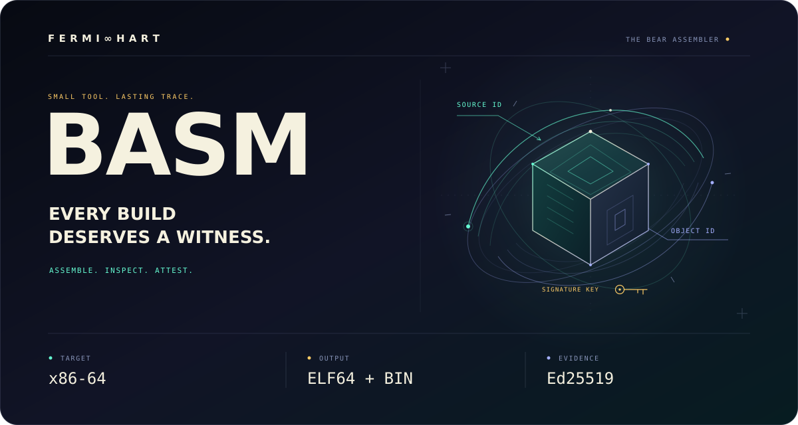

<!-- Copyright (c) 2026, F E R M I ∞ H A R T <contact@fermihart.com> -->
<!-- SPDX-License-Identifier: BSD-3-Clause -->

<p align="center">
  <picture>
    <source media="(max-width: 600px)" srcset="readme/hero-basm-mobile.svg">
    
  </picture>
</p>

<h1 align="center">BASM — Every build deserves a witness.</h1>

<p align="center">
  <strong>Assembly. Analysis. Evidence you can verify.</strong><br>
  <a href="#watch-it-build-then-change-one-byte">WATCH IT WORK</a> ·
  <a href="#get-the-development-candidate">GET BASM</a> ·
  <a href="https://fermihart.github.io/basm/">OPEN THE WEBSITE</a> ·
  <a href="#start-with-one-file">BUILD SOMETHING</a> ·
  <a href="#what-the-witness-remembers">FOLLOW THE EVIDENCE</a>
</p>

A program begins as an idea. A few instructions. A decision about what a
machine should do next.

Then the source becomes bytes.

Someone, somewhere, receives the result. **What was built? From which inputs?
With which tool? Has the object changed?**

Basm brings those questions into the assembly workflow. It builds a documented
subset of NASM-style x86-64 source into ELF64 objects or flat binaries, offers
structured inspection, and can emit a signed record that binds the object to
its consumed inputs, configuration and assembler identity.

**Write the instructions. Build the artifact. Bring the evidence.**

## Watch it build. Then change one byte.

<p align="center">
  <a href="readme/basm-in-action.mp4">
    <picture>
      <source media="(max-width: 600px)" srcset="readme/basm-in-action-mobile.gif">
      
    </picture>
  </a>
</p>

<p align="center">
  <a href="readme/basm-in-action.mp4"><strong>Watch the film — MP4</strong></a> ·
  <a href="readme/basm-in-action-mobile.mp4">Mobile MP4</a>
</p>

<p align="center"><em>Real command output, rendered for readability. Typing and
pauses are edited; this is not a speed benchmark. The demo uses a synthetic test
key and attests the ELF object. Linking and execution are shown separately.</em></p>

| Build it | Give it a witness | Put the witness to work |
|---|---|---|
| Assemble, link and run a Linux program | Emit v4 evidence signed with Ed25519 | Verify against a supplied public key and the selected assembler binary |

The original object passes. Change one byte in that same file and verification
reports an **output hash mismatch**. Restore the exact original bytes and the
original record passes again.

A separate negative check supplies the wrong public key. The verifier rejects
the signer.

**One byte. A different answer.**

## Get the development candidate

**0.1.0-dev.1 is a development candidate for Linux x86-64.** Choose the
sovereign binary to use the assembler directly, or the source to build it.

| Download | Use |
|---|---|
| [Linux x86-64 binary](https://github.com/FermiHart/basm/raw/refs/heads/main/downloads/0.1.0-dev.1/bear-basm-0.1.0-dev.1-linux-x86_64.tar.gz) · [SHA-256](https://github.com/FermiHart/basm/raw/refs/heads/main/downloads/0.1.0-dev.1/bear-basm-0.1.0-dev.1-linux-x86_64.tar.gz.sha256) | Public assembler built with Bear, BearLinker and blibc |
| [Source archive](https://github.com/FermiHart/basm/raw/refs/heads/main/downloads/0.1.0-dev.1/bear-basm-0.1.0-dev.1-source.tar.gz) | Build and inspect the source; includes the demonstration |
| [Host diagnostic archive](https://github.com/FermiHart/basm/raw/refs/heads/main/downloads/0.1.0-dev.1/bear-basm-0.1.0-dev.1-linux-x86_64-host-diagnostic.tar.gz) | Contributor build with the host compiler, identified separately |

Download the binary archive and its sibling checksum into the same directory:

```sh
sha256sum -c bear-basm-0.1.0-dev.1-linux-x86_64.tar.gz.sha256
tar -xzf bear-basm-0.1.0-dev.1-linux-x86_64.tar.gz
cd bear-basm-0.1.0-dev.1-linux-x86_64
./bin/basm --version
./bin/basm -f elf64 -o hello.o examples/hello_linux_x86_64.basm
```

The assembler binary runs **without Python, Perl, Make, a C compiler or the
Bear toolchain**. Linking and running the resulting example additionally needs
a Linux ELF linker. Use the binary in place, or optionally install this
sovereign package with Python 3.10+:

```sh
python3 install.py --prefix "$HOME/.local"
"$HOME/.local/bin/basm" --help
```

Installation does not edit your shell configuration or `PATH`. The host
diagnostic archive can be run directly; the installer accepts the sovereign
package. The archive checksums and file manifests are **unsigned**: matching
hashes detect changes relative to the supplied values, not publisher identity.

The film's ELF inspection and full scripted demo also use `elftool`. Build
that companion with `make host` from a source checkout; the binary archive
above distributes the assembler. See [download and package usage](downloads/README.md),
[build and installation](docs/BUILD.md), [supported syntax and forms](SUPPORTED-SUBSET.md),
[testing](docs/TESTING.md) and [security scope](SECURITY.md).

## Start with one file

On Linux x86-64, clone the source, build the contributor tools and run the
included example. For an existing checkout, start at `make host` from the
repository root:

```sh
git clone https://github.com/FermiHart/basm.git
cd basm
make host
build/host/basm -f elf64 -o hello.o demo/hello.basm
ld -o hello hello.o
./hello
```

```text
Hello from BearBasm!
```

The host build needs a C compiler, Make, Python 3.10+ and Perl. Running the
example also needs a Linux ELF linker. The assembled program uses Linux system
calls directly.

With `basm` on your `PATH`, ordinary assembly takes one command:

```sh
basm -f elf64 -o module.o module.basm
```

Attestation and explanation are explicit options. They do not require a network
service, an account or a cloud signing provider.

<details>
<summary><strong>Choose the build that matches your work</strong></summary>

| Build | Command | Purpose |
|---|---|---|
| Contributor | `make host` | Build with a host C compiler; includes the public assembler and host inspection tools |
| Sovereign | `make BEYOND_ROOT=/path/to/Beyond_BDM` | Build with the explicitly supplied Bear, BearLinker and blibc toolchain |
| Compatibility | `make sovereign-compat BEYOND_ROOT=/path/to/Beyond_BDM` | Retain the separate Beyond-facing bootstrap-capable executable |

The public executable has a fixed 64-bit encoding mode, with ordinary operand
widths within that mode. Existing bootstrap consumers use their matching
compatibility profile. Both builds share the same assembler implementation.

Create development packages from the source checkout:

```sh
make package-source
make package-host
# Sovereign package with an explicit existing Beyond toolchain:
make package BEYOND_ROOT=/path/to/Beyond_BDM
```

Packages are written to `dist/`. Source packaging uses explicitly tracked files;
see [the build guide](docs/BUILD.md) for prerequisites, manifests, staging and
removal.

</details>

## What the witness remembers

An object hash identifies the output bytes. Basm's v4 record also binds the
assembly context: consumed inputs, configuration, assembler and profile.

<details>
<summary><strong>Look inside the signed record</strong></summary>

| Recorded identity | What it refers to |
|---|---|
| **Source and dependencies** | The source, includes and binary inclusions consumed by the assembler |
| **Expanded input and configuration** | Digests of the expanded source and assembly configuration |
| **Assembler** | The executable used to produce the object |
| **Output and profile** | The emitted artifact, its format and the selected profile/bootstrap policy |
| **Signature** | The signed record, checked against the public key selected by the verifier |

</details>

The producer captures input bytes when they are consumed. Verification uses
the signed record and compares the referenced files. A public key supplied
outside the record establishes which signer the consumer expects.

**The artifact has an identity. The record has a signer. The consumer chooses
what to trust.**

## Inspect the output

Assembly is a close conversation with a machine. The tool should let you look
at what it emitted.

Basm can list its supported instructions and modeled forms, emit an assembly
trace, and report diagnostics as JSON. The companion `elftool` reads ELF
structure, audits its documented invariants, compares objects and verifies
attestation records.

```sh
build/host/basm --capabilities
build/host/basm --target-profile public --list-instructions
build/host/basm --target-profile public --explain \
  -f elf64 -o hello.o demo/hello.basm
build/host/elftool audit hello.o
```

The trace exposes source origins, emitted byte spans and modeling coverage.
Unmodeled instructions remain explicitly marked. Trace bytes describe the
object before link-time relocation.

## Reproduce the moment

The demonstration helper creates a fresh workspace, runs the actual tools,
checks the expected outcomes and records their output. It changes one byte in
an object, verifies rejection, restores the exact original and verifies again.
It also checks rejection of an unexpected signer.

```sh
BASM="$PWD/build/host/basm" \
ELFTOOL="$PWD/build/host/elftool" \
  sh demo/run.sh --output-dir /tmp/basm-demo
```

Use a new output directory for each capture. The helper uses a clearly
identified synthetic demonstration key. It is not a release-signing identity.

<details>
<summary><strong>Read the evidence precisely</strong></summary>

This presentation shows the `0.1.0-dev.1` development candidate on Linux x86-64.
The captured assembler is the sovereign public build; its companion `elftool`
is a host build. Reproduction can also use the explicit host assembler above.

The signed record in the film describes **`hello.o`**. It does not attest the
linked executable, its execution or an entire capsule. Current v4 verification
needs the referenced source, output and dependency files at resolvable recorded
paths; the expanded-input and configuration hashes are recorded commitments.

Signatures authenticate recorded evidence under a selected key. Functional
correctness, memory safety and runtime confinement require their own
verification. The current explanation model reports semantic verification as
unimplemented.

The public distribution scope is Linux x86-64, ELF64 relocatable objects and
flat binaries. Native Windows/macOS packages, complete NASM compatibility and a
stable release-signing identity are outside this candidate's claims.

The hero illustration is original decorative geometry. The console output in
the film comes from actual program execution. Neither the geometry nor the
editorial timing is a security measurement or performance result.

</details>

---

**You wrote the instructions. Let the result bring its evidence.**

**F E R M I ∞ H A R T**

[contact@fermihart.com](mailto:contact@fermihart.com)

[BSD-3-Clause](LICENSE) · [Notices](NOTICE) · [Per-file licensing](REUSE.toml) ·
[Presentation license](readme/LICENSE.media.txt).

[Live project site](https://fermihart.github.io/basm/) ·
[HTML presentation source](index.html) — open it locally with the adjacent
`readme/` assets. The GitHub file view shows source; a separate site deployment
is not required to use this repository.
